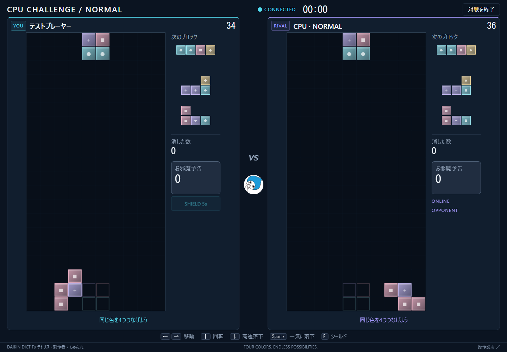
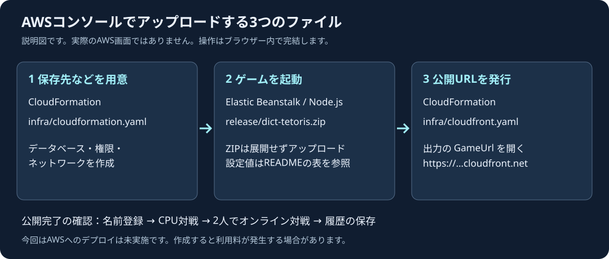

# DAIKIN DICT F9 テトリス

**製作者：ちゅん丸**

同じ色のブロックを上下左右に4個以上つなげて消す、オンライン／CPU対戦ゲームです。名前だけで始められます。IDとパスワードは不要です。

文字を大きくし、盤面とNEXTのブロックを拡大しました。PCでは画面の高さに合わせ、ホーム・対戦画面をスクロールなしで使える配置にしています。攻撃は先に自分へのお邪魔と相殺し、残りだけ相手へ送ります。相殺時は盤面上に「相殺！」と打ち消した個数、予告の残数を大きく表示します。



[相殺したときの表示例](docs/images/cancellation.png)

## 自分のPCで遊ぶ

[Node.js](https://nodejs.org/) 22以降のLTS版をインストールしてください。Node.jsはゲームのサーバーを動かすソフト、npmは必要な部品をそろえる付属ツールです。ローカル動作の最低要件はNode.js 20です。

このフォルダーでPowerShellを開き、次を実行します。これはPC内で遊ぶための操作で、AWSのコマンドではありません。

```powershell
npm ci
npm start
```

ブラウザーで **http://localhost:3000** を開きます。終了はPowerShellで `Ctrl+C`。初回だけ `npm ci` が必要です。

1. 名前を1〜16文字で入力します。
2. 「CPUと対戦する」、または「対戦相手を探す」を押します。
3. オンライン対戦では、2人が同じURLを開いて相手を探します。

同じPCで2人分を試す場合は、通常のウィンドウとシークレットウィンドウを使います。同じブラウザーの通常タブは同じプレーヤーを共有します。

名前と履歴はブラウザーのCookie（サイトが保存する小さな識別情報）で引き継ぎます。有効期間は登録・名前変更から最大365日です。**Cookie削除、別の端末・ブラウザー、有効期限切れでは引き継げません。** 同じ名前を入力しても他人の履歴には入れません。右上の「名前を変更」で履歴を保ったまま改名できます。履歴画面では、保存済みのオンライン対戦を相手ごとにまとめ、勝率、勝敗、プレイ回数、合計・平均ゲーム時間を確認できます。

## 操作とルール

| 操作               | キー  |
| ------------------ | ----- |
| 左右移動           | ← / → |
| 回転               | ↑     |
| 高速で下に落とす   | ↓     |
| 一気に落として固定 | Space |
| 1試合1回のシールド | F     |

スマートフォンでは画面下のボタンを使います。盤面は横9×縦15。次のブロックを出せなくなるか、お邪魔が天井に届くと負けです。自動落下は試合中ずっと0.65秒間隔で、時間経過により加速しません。オンライン戦・CPU戦とも最大5分で、時間切れは盤面に固定済みのブロックが少ない方の勝利、同数なら引き分けです。下キーの長押しは60ms間隔です。

- 同じ色4個以上を上下左右につなげると消去。消去後に落ちたブロックがさらに消えると連鎖です。
- 攻撃個数は `floor(消去数 / 4) + 連鎖数 - 1 + floor(コンボ数 / 2)`（最大6個）。連続して消すとコンボが増えます。
- 自分への予告お邪魔を先に相殺し、余った攻撃だけ相手に送ります。例：予告3個に攻撃2個なら残り1個、予告2個に攻撃3個なら相手へ1個。両者が同じ強さで消せば相殺されます。
- 予告から1.2秒以上たち、色を消さなかった着地で、お邪魔が降り始めます。消去した着地では降りません。
- 1回最大6個、落下0.15秒＋間隔0.05秒（約0.2秒間隔）で1個ずつ落ちます。6個の落下は約1.4秒以内に終わります。その間は次のブロックを待ちます。予告スタックも最大6個で、超過分は追加しません。
- 相殺すると「○個 打ち消した！」「予告○個 → 残り○個」を0.25秒間表示します。画面横のお邪魔予告も個数と灰色のマークで確認できます。
- 灰色のお邪魔は、隣の色ブロックを消すと一緒に消えます。消去後は全列の空洞を詰め、次の連鎖は消去の影響で実際に動いた色ブロックだけを起点に判定します。
- シールドは待機中のお邪魔を最大4個消し、5秒間は攻撃1回につき最大4個を防ぎます。落下中でも使えます。
- ホーム右端の「CHEAT MODE」を押し、パスワード **`tomo`** を入力するとONになります。チートをONにしたプレーヤーは、オンライン戦・CPU戦のどちらでも5秒ごとに相手へお邪魔を2個送ります。もう一度ボタンを押すとOFFです。パスワードはサーバーで確認し、対戦ログには保存しません。

CPUはEASY／NORMAL／HARDの全難易度で操作速度と配置の正確さを控えめに調整しています。配置間隔はそれぞれ約2.4秒／1.6秒／0.9秒です。

床際では上方向への回転補正を行います。お邪魔落下中に押した回転も次のブロックへ1回分ずつ予約されるため、オンライン対戦中の入力が消えません。消去判定は今置いたブロック、または連鎖で動いた列に関係する同色グループだけを対象にし、離れた場所のブロックが突然まとめて消えることを防ぎます。

相殺の考え方は[SEGA公式「ぷよぷよテトリス2S」マニュアル](https://manual.sega.jp/puyopuyotetris2/S/jp/)を参考にしています。このゲームの盤面・攻撃量・落下時間は独自の設定です。

## AWSに公開する手順：ブラウザーだけで操作

**今回はAWSにデプロイしていません。以下は後日、自分で公開するための手順です。AWS CLI、CloudShell、Dockerの操作は不要です。** ZIPと2つの設定ファイルを、AWSの管理画面でアップロードします。画面によってはドラッグ＆ドロップではなく「ファイルの選択」を使います。

ZIPだけで公開するために、以前のECS／ECR構成から **Elastic BeanstalkのNode.js環境** に変更しました。S3へのHTMLアップロードだけでは対戦を処理するサーバーが動かないため、ゲーム全体を動かせるサービスを使います。



上の図は説明用です。実際のAWS画面のスクリーンショットではありません。画面の表記や配置が変わったときは、括弧内の英語名も目印にしてください。

### まず知っておく言葉

| 用語                                | このゲームでの役割                                                 |
| ----------------------------------- | ------------------------------------------------------------------ |
| AWSコンソール                       | ブラウザーで開くAWSの管理画面                                      |
| リージョン                          | サーバーを置く地域。今回は東京 `ap-northeast-1`                    |
| CloudFormation                      | 設定ファイルを読み、必要なAWSの部品を作るサービス                  |
| テンプレート／YAML                  | どの部品を作るか記載した設定ファイル。編集せずアップロードします   |
| スタック                            | CloudFormationでまとめて作る部品のグループ                         |
| Elastic Beanstalk                   | アップロードしたプログラムをサーバーで動かすサービス               |
| EC2インスタンス                     | AWS上で動くコンピューター。今回は1台だけ使います                   |
| DynamoDBテーブル                    | 名前、ブラウザーの識別情報、対戦履歴の保存場所                     |
| IAMロール／インスタンスプロファイル | サーバーに必要な操作権限を渡す仕組み。アクセスキーの入力は不要です |
| VPC／サブネット                     | サーバーを配置するネットワークと、その中の区画                     |
| 環境変数                            | サーバーに渡す設定。画面の「名前」「値」に入力します               |
| CloudFront                          | プレーヤーが使うHTTPSの公開URLを用意する入口                       |
| HTTPS／WebSocket                    | 暗号化したWeb通信／対戦状態をやり取りする常時接続                  |
| デプロイ                            | プログラムをサーバーへ置き、利用できる状態にすること               |

### AWS構成とログの見方

このリポジトリで作るAWS構成は次のとおりです。CloudFormationの `dict-tetoris-base` スタックがVPC・公開サブネット・DynamoDB・IAMロールを作り、`dict-tetoris-web` スタックがCloudFrontを作ります。Elastic Beanstalk環境だけは、間にある手順2で専用ZIPをアップロードして作成します。

```text
プレーヤーのブラウザー
  │ HTTPS / WSS
  ▼
CloudFront（公開URL、HTTPS、ORIGIN_SECRETヘッダー付与）
  │ HTTP / WebSocket
  ▼
Elastic Beanstalk: dict-tetoris-env（東京リージョン、EC2 1台）
  ├─ nginx ──► Node.js / Express / WebSocket（PORT 8080）
  │              ├─ 待機列・進行中の対戦：プロセス内メモリ
  │              └─ 名前・セッション・対戦履歴 ──► DynamoDB
  └─ アプリ・デプロイ・nginxログ ──► CloudWatch Logs（7日保存）
```

AWSで問題が起きたら、まず **Elastic Beanstalk → 環境 `dict-tetoris-env` → ログ（Logs）** を開きます。このZIPはインスタンスログのCloudWatch転送を有効にし、7日保存、環境を終了しても保存期間内は削除しない設定です。AWS公式手順どおり「ログをリクエスト（Request logs）→ 最後の100行（Last 100 lines）」でも直近ログを取得できます。CloudWatchへ転送済みのロググループは同じ画面から開くか、**CloudWatch → ロググループ**で確認します。

| 見たい内容                           | ログ／画面                                                        | 主な確認点                                                                                                 |
| ------------------------------------ | ----------------------------------------------------------------- | ---------------------------------------------------------------------------------------------------------- |
| ゲームサーバーの起動・対戦保存・例外 | `/aws/elasticbeanstalk/dict-tetoris-env/var/log/web.stdout.log`   | `match_finished`、`match_save_failed`、`request_error`、`upgrade_error`。Node.jsの標準出力・標準エラーです |
| ZIPの展開・npm install・起動失敗     | `/aws/elasticbeanstalk/dict-tetoris-env/var/log/eb-engine.log`    | デプロイ時刻付近の `ERROR`、依存関係、起動コマンド                                                         |
| 502・画面が開かない・WebSocket切断   | `/aws/elasticbeanstalk/dict-tetoris-env/var/log/nginx/error.log`  | upstream、8080番への接続、WebSocketプロキシのエラー                                                        |
| HTTPアクセスの有無・ステータス       | `/aws/elasticbeanstalk/dict-tetoris-env/var/log/nginx/access.log` | `/health`、APIパス、403/5xx。Cookieやチート用パスワードはアプリからログ出力しません                        |
| 環境全体の異常                       | Elastic Beanstalkの「ヘルス」「イベント」「モニタリング」         | デプロイ失敗、EC2状態、CPU、通信量                                                                         |
| 保存された名前・履歴                 | DynamoDB → テーブル → 項目を探索                                  | `PROFILE`、`SESSION`、`MATCH#...`。これはログではなく保存データです                                        |

環境名を変更した場合は、ロググループ名の `dict-tetoris-env` 部分もその環境名になります。CloudFrontの標準アクセスログはこのテンプレートでは有効にしていないため、通常の調査はBeanstalk／CloudWatch Logsから始めます。[Elastic Beanstalkで最後の100行を取得するAWS公式手順](https://docs.aws.amazon.com/elasticbeanstalk/latest/dg/GettingStarted.html)と[CloudWatch Logsのログ種別・命名規則](https://docs.aws.amazon.com/elasticbeanstalk/latest/dg/AWSHowTo.cloudwatchlogs.html)も参照してください。

### 0. 費用とファイルを準備する

EC2、公開IPv4アドレス、DynamoDB、CloudFront、S3、ログ保存などに料金がかかる場合があります。**遊んでいない時間もEC2等の料金は発生します。無料とは限りません。** AWSコンソールの「Billing and Cost Management」→「Budgets」で、使う前に自分の予算と通知を設定してください。予算通知は自動停止ではありません。金額は[AWS料金計算ツール](https://calculator.aws/)で利用時点の条件を確認します。

GitHubから取得する場合は、[このリポジトリ](https://github.com/kosukechun/DICT_tetoris)の緑色の **Code → Download ZIP** を選び、ダウンロードした全体ZIPを右クリック→「すべて展開」します。展開したフォルダー内に、次の3ファイルがあります。

| ファイル                                                 | 使う場所                 | どう扱うか                                |
| -------------------------------------------------------- | ------------------------ | ----------------------------------------- |
| [`infra/cloudformation.yaml`](infra/cloudformation.yaml) | 手順1のCloudFormation    | 編集せずアップロード                      |
| [`release/dict-tetoris.zip`](release/dict-tetoris.zip)   | 手順2のElastic Beanstalk | **このZIPは展開せず**そのままアップロード |
| [`infra/cloudfront.yaml`](infra/cloudfront.yaml)         | 手順3のCloudFormation    | 編集せずアップロード                      |

**GitHubから取得した全体ZIPを、そのままBeanstalkに渡さないでください。** 用意した `release/dict-tetoris.zip` には必要なファイルだけが正しい階層で入っています。ZIP内の一番上に `package.json` が必要で、余計な親フォルダーを含めないのが[AWSの要件](https://docs.aws.amazon.com/elasticbeanstalk/latest/dg/applications-sourcebundle.html)です。

自分のAWSアカウントにサインインし、右上の地域を **アジアパシフィック（東京）** にします。操作するユーザーにはCloudFormation、IAM、VPC／EC2、Elastic Beanstalk、DynamoDB、S3、CloudFront等を作成する権限が必要です。アクセス拒否が出た場合はアカウントの管理者に確認してください。

### 1. 保存先・権限・ネットワークを作る

1. AWS画面上部の検索で **CloudFormation** を開きます。
2. 「スタックの作成」→「新しいリソースを使用（標準）」を選びます。
3. 「既存のテンプレートを選択」→「テンプレートファイルのアップロード」→「ファイルの選択」で **`infra/cloudformation.yaml`** を指定します。
4. 「次へ」。スタック名を **`dict-tetoris-base`** にします。
5. 「次へ」で進み、オプションは初期値のままで構いません。
6. 最後の確認画面で、IAMリソースを作成する旨のチェックを入れ、「送信」または「スタックの作成」を押します。これはゲーム用の権限を作るための確認です。
7. 「イベント」画面で更新ボタンを押し、状態が **`CREATE_COMPLETE`** になるまで待ちます。作成中は `CREATE_IN_PROGRESS` です。
8. 「出力（Outputs）」タブを開き、次の**値**をメモします。左のキー名そのものではなく、右側の長い文字列をコピーします。

| 出力のキー            | 次に貼り付ける場所                        |
| --------------------- | ----------------------------------------- |
| `ServiceRoleName`     | Beanstalkのサービスロール                 |
| `InstanceProfileName` | BeanstalkのEC2インスタンスプロファイル    |
| `VpcId`               | BeanstalkのVPC                            |
| `PublicSubnetId`      | Beanstalkのインスタンスサブネット         |
| `GameTableName`       | Beanstalkの環境変数 `DYNAMODB_TABLE` の値 |

このファイルだけではゲームのサーバーは起動しません。次へ進みます。

### 2. ゲームZIPをアップロードしてサーバーを起動する

1. 画面上部の検索で **Elastic Beanstalk** を開きます。地域は東京のままです。
2. 「アプリケーションを作成」または「環境を作成」を押します。方式の選択がある場合は **Standard**（標準）を使います。
3. 環境は **ウェブサーバー環境（Web server environment）**、アプリケーション名は `dict-tetoris`、環境名は `dict-tetoris-env` とします。
4. プラットフォームは **マネージドプラットフォーム → Node.js → Node.js 22／Amazon Linux 2023** を選び、表示される推奨バージョンを使います。DockerやPythonは選びません。
5. アプリケーションコードは「コードのアップロード」→「ローカルファイル」。**`release/dict-tetoris.zip`** を選びます。バージョンラベルは `v1` などです。
6. プリセットは **単一インスタンス（Single instance）** を選びます。Spotではない通常のインスタンスを使います。
7. 「サービスアクセス」の既存サービスロールに、手順1の **`ServiceRoleName` の値**を選びます。EC2インスタンスプロファイルには **`InstanceProfileName` の値**を選びます。SSH用のキーペアは未設定で構いません。
8. 「ネットワーク」で **`VpcId` の値**と **`PublicSubnetId` の値**を選び、「パブリックIPアドレス」を有効にします。「データベース」は追加しません。保存先は手順1で作ったDynamoDBです。
9. 容量／インスタンス設定で、アーキテクチャ **x86_64**、種類 **`t3.small`** を選びます。台数は1台です。更新のデプロイポリシーは **All at once（一括）** にします。
10. 「更新、モニタリング、ログ記録」等の設定内にある「環境プロパティ（Environment properties）」に、以下の名前と値を入力します。ソースの選択がある場合は通常のプレーンテキストを選びます。

| 名前             | 値                                                    |
| ---------------- | ----------------------------------------------------- |
| `PORT`           | `8080`                                                |
| `NODE_ENV`       | `production`                                          |
| `TRUST_PROXY`    | `2`                                                   |
| `AWS_REGION`     | `ap-northeast-1`                                      |
| `DYNAMODB_TABLE` | 手順1の `GameTableName` の値                          |
| `ORIGIN_SECRET`  | 自分で用意した32〜128文字のランダムな英数字・`_`・`-` |

`ORIGIN_SECRET` はCloudFrontの入口を通ったアクセスか確認するための合言葉です。パスワード管理ソフト等でランダムに作り、手順3でも**同じ値**を使います。プレーヤーが入力するパスワードではありません。GitHubには書かず、自分で控えてください。

11. CloudWatch Logsへのログ転送と7日保存はZIP内の `.ebextensions/01-app.config` で有効になります。画面側にも同じ設定が表示されることを確認します。自動スケーリングや追加のデータベースは不要です。
12. 内容を確認して「送信／環境を作成」。状態が **Ready／正常（緑）** になるまで待ちます。初回は10〜20分程度かかる場合があります。
13. 環境の概要にある **ドメイン** をコピーします。例：`dict-tetoris-env.xxxxx.ap-northeast-1.elasticbeanstalk.com`。`http://` と最後の `/` を取り除いて控えます。

この時点でBeanstalkのURLを直接開くと **403** になります。入口の制限が動いている状態です。`/health` だけは生存確認用に開けます。ゲームは次の手順で発行するHTTPSのURLから開きます。

Node.jsの起動方法は同梱の `Procfile`、ポート等は `.ebextensions`、対戦通信用の設定は `.platform` に含めています。これらを個別に編集・アップロードする必要はありません。[AWSのNode.jsプラットフォーム説明](https://docs.aws.amazon.com/elasticbeanstalk/latest/dg/create_deploy_nodejs.container.html)と[nginx設定の説明](https://docs.aws.amazon.com/elasticbeanstalk/latest/dg/platforms-linux-extend.proxy.html)を基にした構成です。

### 3. HTTPSの公開URLを作る

1. **CloudFormation** に戻り、手順1と同じ「スタックの作成」を開きます。
2. 今度は **`infra/cloudfront.yaml`** をアップロードします。
3. スタック名は **`dict-tetoris-web`** とします。
4. パラメーター `BeanstalkDomain` に、手順2の **ドメインだけ**を貼ります。
5. パラメーター `OriginSecret` に、Beanstalkの **`ORIGIN_SECRET` と同じ値**を貼ります。大文字小文字や余分な空白に注意します。
6. 「次へ」で確認まで進み、スタックを作成します。CloudFrontの準備に時間がかかるため `CREATE_COMPLETE` まで待ちます。
7. 「出力」の **`GameUrl` の値**を開きます。`https://……cloudfront.net` がゲームの公開URLです。独自ドメインの購入は不要です。

CloudFrontはこの設定ファイルで、全体のキャッシュを無効にし、Cookie・Host・Origin等をサーバーへ渡す設定になります。これにより、他のプレーヤーの応答の使い回しを防ぎ、名前登録とWebSocket接続を動かします。[AWSのキャッシュ無効ポリシー](https://docs.aws.amazon.com/AmazonCloudFront/latest/DeveloperGuide/using-managed-cache-policies.html)、[全リクエスト情報の転送ポリシー](https://docs.aws.amazon.com/AmazonCloudFront/latest/DeveloperGuide/using-managed-origin-request-policies.html)、[WebSocketの説明](https://docs.aws.amazon.com/AmazonCloudFront/latest/DeveloperGuide/distribution-working-with.websockets.html)を参照しています。

### 4. ここまで確認できれば公開完了

- 公開URLが `https://` で開き、名前だけを登録できる。
- CPU対戦を始め、キー／スマートフォンのボタンで操作できる。
- 2台の端末で同じ公開URLを開き、「対戦相手を探す」で対戦できる。
- お邪魔を相殺でき、残ったお邪魔が上から1個ずつ落ちてくる。
- 試合終了後に「対戦ログを保存しました」と出て、再読み込み後も履歴が見える。

**この手順は設定ファイルとローカルでの検証まで実施済みで、AWSアカウント上での作成・動作確認は未実施です。** 手順4が実際の環境での最終確認です。

### 更新するとき

Elastic Beanstalk → 自分の環境 → **アップロードとデプロイ** で、新しい `dict-tetoris.zip` を指定します。バージョン名は `v2` などに変えます。公開URLと環境変数は引き継ぎます。更新中は一時停止し、対戦も切断されるため、遊んでいない時間に実施してください。

自分でソースコードを編集した場合、開発者はPCで `python scripts/package_release.py` を実行してZIPを作り直します。GitHubのActionsでもテスト後に `aws-console-upload` という成果物を保存します。成果物をダウンロードした場合は外側を展開し、中の **`dict-tetoris.zip`** を使います。AWSへの自動デプロイは行いません。

### うまくいかないとき

| 症状                                 | 確認する場所と対処                                                                                         |
| ------------------------------------ | ---------------------------------------------------------------------------------------------------------- |
| CloudFormationが `ROLLBACK_COMPLETE` | 「イベント」の赤い失敗理由を確認。IAM権限、上限数、地域を確認してから失敗したスタックを削除し、再作成      |
| Beanstalkのサービスロールが選べない  | 手順1が `CREATE_COMPLETE` か、同じAWSアカウントかを確認。選択肢を更新                                      |
| Beanstalkが赤い／502                 | 「ログ」→「ログのリクエスト」→「最後の100行」。Node.js 22、正しいZIP、`PORT=8080`、VPCとパブリックIPを確認 |
| 公開URLが403                         | CloudFrontとBeanstalkの合言葉が完全一致しているか確認。Beanstalk直アクセスの403は正常                      |
| 名前登録できない／保存失敗           | `DYNAMODB_TABLE` に出力の値を入れたか、東京か、指定のインスタンスプロファイルかを確認                      |
| 画面は出るが対戦できない             | 正式なHTTPSのURLを使う。別タブで同じプレーヤーが接続していないか確認。`.platform` を含んだ専用ZIPを使う    |
| CloudFrontが502                      | ドメインに `http://` や `/` がないか、BeanstalkがReadyかを確認                                             |
| 名前・履歴が消えたように見える       | 同じURL・端末・ブラウザーか確認。Cookieを削除した場合、名前だけでは復元できません                          |

### 利用をやめるとき：料金を止める

1. Beanstalkの「アクション」→ **環境の終了**。EC2画面だけで停止しても再作成されることがあるため、環境を終了します。
2. CloudFormationの **`dict-tetoris-web`** を削除。完了まで待ちます。
3. Beanstalkの環境終了後、アプリケーションバージョンで不要な版を削除します。S3上のソースも削除する選択肢があれば確認します。
4. CloudFormationの **`dict-tetoris-base`** を削除します。
5. **DynamoDBはデータ保護のため残す設定です。** 完全に不要なら、手順1で控えたテーブルをDynamoDBの画面で削除します。これは名前・履歴の削除になります。
6. CloudWatch Logsのロググループ、S3のBeanstalk用バケット／保存版、EC2の未使用Elastic IP・ディスクも確認します。他のアプリが使うものは削除しません。最後に請求画面で残る利用料を確認します。

今回は小規模に遊ぶための1台構成です。故障や更新中は停止し、進行中の試合は復元できません。台数を増やすには対戦部屋の共有処理が必要なので、台数は1のままにしてください。プレーヤーから入口までがHTTPS、CloudFrontからBeanstalkまではHTTP＋合言葉です。全区間の暗号化や大規模運用は追加設計が必要です。

## テスト：pytestもあります

既存のJavaScriptテストに加え、Pythonの **pytest** で実サーバーのHTTP APIを検証します。ゲームの中身はJavaScriptなので、ルールはNode.js、画面はPlaywright、登録等はpytestで確認します。

```powershell
npm test
python -m venv .venv
.venv\Scripts\python.exe -m pip install -r requirements-dev.txt
.venv\Scripts\python.exe -m pytest
.venv\Scripts\cfn-lint.exe -r ap-northeast-1 -t infra/cloudformation.yaml infra/cloudfront.yaml
npx playwright install chromium
npm run test:browser
```

Nodeテストでは消去・連鎖・両者の攻撃順を変えた相殺・回転・落下間隔・シールド・天井到達・CPU・オンライン対戦・再起動後の履歴保存を検証します。回転は全7形状について中央・左右壁・床の28項目に、完全ブロック、1〜4回の入力予約、CPU全難易度、オンライン両席・同時入力・お邪魔中入力を加えた項目を個別に検証します。さらに、5分ちょうどのCPU／オンライン時間切れ、盤面ブロック数判定、同数引き分け、チートの誤パスワード拒否と5秒ごとの2個攻撃、10分経過後も落下間隔が変わらないことを検証します。pytestからもこれらの対戦ルール、回転スイート、オンライン相当の2盤面を仮想時間で10分動かす長時間テストを実行します。PlaywrightではPC／スマートフォンの登録から対戦、チートのON/OFF、結果、履歴、改名まで実際のブラウザーで操作します。

## ファイルの役割と保存先

| 場所                                       | 内容                                        |
| ------------------------------------------ | ------------------------------------------- |
| `public/`                                  | HTML、画面の動き、デザイン、画像            |
| `shared/engine.js`                         | 消去、相殺、お邪魔落下などのゲームルール    |
| `server/`                                  | 対戦、CPU、ブラウザー識別、保存処理         |
| `tests/`                                   | Node.js、pytest、ブラウザーテスト           |
| `infra/`                                   | AWSコンソールに渡す2つの設定ファイル        |
| `release/dict-tetoris.zip`                 | Beanstalkにアップロードする完成済みファイル |
| `.platform/`・`.ebextensions/`・`Procfile` | ZIPに含めるサーバー設定                     |
| `scripts/package_release.py`               | 開発者用のZIP作成。AWSには接続しません      |
| `docs/`                                    | 補足資料と画像                              |

ローカルの保存先は `data/database.json`、AWSはDynamoDBです。試合ログは終了時に保存し、直近20試合を画面に表示します。進行中の試合はサーバーのメモリにあります。詳細は[設計](docs/設計.md)を参照してください。
